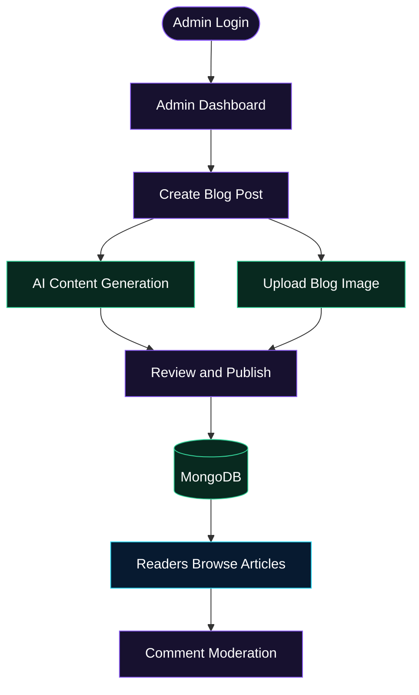

 <a id="top"></a>

<div align="center">


<br/>


### ✦ Create smarter. Publish faster. Share ideas. ✦

An AI-powered blogging platform combining intelligent content creation, modern blog management, and a streamlined publishing experience.

<br/>

<a href="https://quick-blog-client-delta-two.vercel.app/">
  
</a>
<a href="https://github.com/chanu2005-wq/AI_powered_blog">
  
</a>
<a href="https://gitdiagram.com/chanu2005-wq/ai_powered_blog">
  
</a>

<br/><br/>


<br/><br/>


<br/>

`IDEA` &nbsp; ◆ &nbsp; `GENERATE` &nbsp; ◆ &nbsp; `PUBLISH` &nbsp; ◆ &nbsp; `INSPIRE`

<br/>

[Overview](#-overview) · [Features](#-features) · [Architecture](#-architecture) · [Tech Stack](#-tech-stack) · [Installation](#-getting-started) · [Deployment](#-deployment) · [Roadmap](#-roadmap)

</div>

---

## 🌌 Overview

**Quick Blog** is a full-stack blogging application built to simplify content creation and blog administration with AI-assisted writing capabilities.

The platform combines a reader-facing blog experience with a dedicated admin workspace for managing articles, uploading images, and moderating comments.

### What it offers

| Capability | Description |
|:--|:--|
| **AI-assisted writing** | Generate blog content using the integrated AI service. |
| **Blog management** | Create, edit, publish, and delete blog posts. |
| **Admin workspace** | Access protected administrative functionality. |
| **Image hosting** | Upload and deliver blog images through ImageKit. |
| **Persistent storage** | Store application data in MongoDB. |
| **Cloud deployment** | Host the frontend and backend independently. |

---

## ✨ Features

<details open>
<summary><strong>🤖 AI-Assisted Content Generation</strong></summary>

Generate blog content using the AI service integrated into the application, supporting a more efficient writing workflow.

</details>

<details>
<summary><strong>📝 Blog Management</strong></summary>

Manage blog posts through the administrative interface, including creating, editing, publishing, and deleting articles.

</details>

<details>
<summary><strong>🔐 Authentication and Authorization</strong></summary>

Use the application's authentication and token-verification flow to protect administrative operations.

</details>

<details>
<summary><strong>🖼️ ImageKit Integration</strong></summary>

Upload blog images and serve them using an external image-hosting service.

</details>

<details>
<summary><strong>💬 Comment Moderation</strong></summary>

Review and moderate reader comments from the admin workspace.

</details>

<details>
<summary><strong>📚 Blog Discovery</strong></summary>

Browse published articles and open individual posts through the reader interface.

</details>

---

## 🏗️ Architecture

<div align="center">

### SYSTEM OVERVIEW

**React + Vite → Express API → MongoDB Atlas + External Services**

<a href="https://gitdiagram.com/chanu2005-wq/ai_powered_blog">
  
</a>

[**Explore the interactive architecture →**](https://gitdiagram.com/chanu2005-wq/ai_powered_blog)

</div>

### Publishing workflow



<sub>Conceptual workflow based on the supplied project documentation.</sub>

### Architecture components

| Component | Responsibility |
|:--|:--|
| **Frontend** | Blog browsing, article views, and reader interactions. |
| **Admin interface** | Administrative authentication, blog management, and comment moderation. |
| **Backend API** | Server-side logic, controllers, routes, and authentication. |
| **MongoDB Atlas** | Persistent application data. |
| **ImageKit** | Blog image hosting and delivery. |
| **AI service** | AI-assisted blog content generation. |

---

## ⚙️ Tech Stack

<div align="center">


</div>

| Layer | Technology | Purpose |
|:--|:--|:--|
| Frontend | React | User interface |
| Build tool | Vite | Frontend development and build tooling |
| Backend | Node.js | Server runtime |
| API | Express.js | Backend routes and application logic |
| Database | MongoDB Atlas | Data persistence |
| Image hosting | ImageKit | Image upload and delivery |
| AI integration | Configured AI provider | AI-assisted writing |
| Frontend hosting | Vercel | Frontend deployment |
| Backend hosting | Render | Backend deployment |
| Language | JavaScript | Application development |

---

## 📂 Project Structure

```text
AI_powered_blog/
├── client/
│   ├── public/
│   ├── src/
│   │   ├── assets/
│   │   │   └── quick-blog.svg
│   │   ├── components/
│   │   ├── pages/
│   │   │   ├── Home.jsx
│   │   │   ├── Blog.jsx
│   │   │   ├── BlogList.jsx
│   │   │   └── admin/
│   │   └── context/
│   │       └── app-context.jsx
│   └── package.json
├── server/
│   ├── configs/
│   ├── controllers/
│   ├── models/
│   ├── routes/
│   ├── middleware/
│   ├── server.js
│   └── package.json
└── README.md
```

<sub>This is an illustrative structure based on the supplied README. Confirm filenames and directories against the actual repository.</sub>

---

## 🚀 Getting Started

Follow these steps to run the application locally.

### Prerequisites

- [Node.js](https://nodejs.org/)
- npm
- [MongoDB Atlas](https://www.mongodb.com/atlas) or a compatible MongoDB instance
- [ImageKit](https://imagekit.io/) credentials
- Credentials for the AI provider configured in the application

### 1. Clone the repository

```bash
git clone https://github.com/chanu2005-wq/AI_powered_blog.git
cd AI_powered_blog
```

### 2. Install backend dependencies

```bash
cd server
npm install
```

Create the backend environment file using the example file if your repository provides one:

```bash
cp .env.example .env
```

Configure the variables required by the backend, such as the database URI, administrator authentication settings, ImageKit credentials, and AI provider key. Use the exact variable names expected by your source code.

Start the backend:

```bash
npm start
```

### 3. Install frontend dependencies

Open a second terminal from the repository root:

```bash
cd client
npm install
```

If a frontend environment example exists, copy it and configure the API base URL according to the application's configuration:

```bash
cp .env.example .env
```

Start the frontend:

```bash
npm run dev
```

Open the local development URL displayed in the terminal.

### 🔑 Environment configuration

The application may require configuration for:

| Configuration | Purpose |
|:--|:--|
| MongoDB connection URI | Database connectivity |
| Admin authentication | Administrator access |
| ImageKit credentials | Image upload and delivery |
| AI provider API key | AI-assisted content generation |
| Frontend API base URL | Connect the client to the backend |
| CORS allowed origin | Permit requests from the frontend |

> [!CAUTION]
> Never commit real credentials, production database URIs, passwords, or private API keys to GitHub. Keep sensitive values in environment variables and configure production secrets through the relevant hosting provider.

**Note:** The `.env.example` commands above are conditional. If those files do not exist in your repository, create the environment files manually using the variable names required by the application.

---

## 🌐 Deployment

<div align="center">

<a href="https://quick-blog-client-delta-two.vercel.app/">
  
</a>

<a href="https://ai-powered-blog-534w.onrender.com/">
  
</a>

<a href="https://www.mongodb.com/atlas">
  
</a>

</div>

| Resource | Link |
|:--|:--|
| Live website | [Open Quick Blog](https://quick-blog-client-delta-two.vercel.app/) |
| Backend host | [Render service](https://ai-powered-blog-534w.onrender.com/) |
| Architecture | [GitDiagram](https://gitdiagram.com/chanu2005-wq/ai_powered_blog) |
| Source code | [GitHub repository](https://github.com/chanu2005-wq/AI_powered_blog) |

<sub>These URLs come from the supplied project documentation. Their current availability has not been independently verified.</sub>

---

## 🔮 Roadmap

The following items are **potential future enhancements**, not claims about existing functionality.

- [ ] Add full-text search, tags, and categories.
- [ ] Introduce a rich-text editing experience.
- [ ] Add AI-generated titles and article summaries.
- [ ] Expand blog analytics.
- [ ] Improve search engine optimization tools.
- [ ] Add related-article recommendations.

---

## 🔒 Security

Recommended practices for maintaining the application:

- Store sensitive configuration in environment variables.
- Enforce authorization on protected backend routes.
- Validate incoming requests.
- Restrict CORS to trusted frontend origins.
- Keep production dependencies and deployment settings secure.
- Never expose private API keys in frontend code or public repositories.

---

## 🤝 Contributing

Contributions, suggestions, and bug reports are welcome.

1. Fork the repository.
2. Create a feature branch.
3. Implement and test your changes.
4. Commit your changes with a descriptive message.
5. Open a pull request explaining the changes.

---

## 👨‍💻 Author

<div align="center">

### Chanukya Chandra

**Full-Stack Development · AI Integration**

<a href="https://github.com/chanu2005-wq">
  
</a>

<br/><br/>

*Built with the MERN ecosystem. Enhanced with AI. Designed for better blogging.*

If you find this project useful, consider giving it a ⭐ on GitHub.

<br/>

[⬆ Back to Top](#top)


</div>
