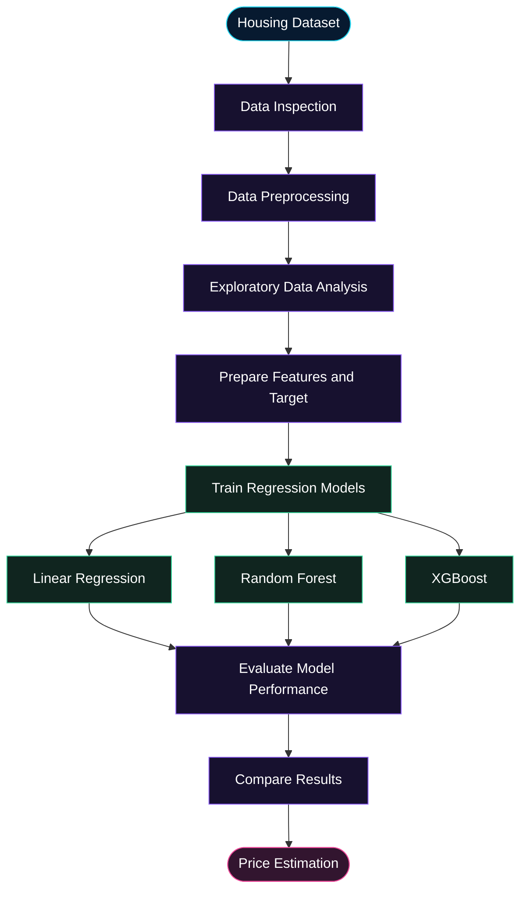

 <a id="top"></a>

<div align="center">

# 🏠 HOUSE PRICE PREDICTION


**Predictive intelligence for smarter property price estimation.**

An exploratory machine-learning project that applies regression algorithms, data preprocessing, visualization, and model evaluation to housing data.

<br/>

<a href="https://github.com/chanu2005-wq/house_price_prediction">
  
</a>
<a href="https://github.com/chanu2005-wq/house_price_prediction/blob/main/house_prediction.ipynb">
  
</a>

<br/><br/>


<br/><br/>


<br/>

`DATA` &nbsp; ◆ &nbsp; `PREPROCESS` &nbsp; ◆ &nbsp; `TRAIN` &nbsp; ◆ &nbsp; `EVALUATE`

<br/>

[Overview](#-overview) · [Features](#-project-features) · [Workflow](#-machine-learning-workflow) · [Tech Stack](#-technology-stack) · [Setup](#-getting-started) · [Structure](#-project-structure) · [Roadmap](#-future-enhancements)

</div>

---

## 🌌 Overview

**House Price Prediction** explores how machine-learning regression algorithms can be used to estimate house prices from housing data.

The project includes a Jupyter notebook and a housing dataset. Its documented scope covers data preprocessing, exploratory visualization, and model evaluation using:

- Linear Regression
- Random Forest
- XGBoost

The goal is to explore housing data, compare regression approaches, and understand how predictive models can support property price estimation.

### Why this project?

| Objective | Description |
|:--|:--|
| **Data preparation** | Prepare housing data for machine-learning analysis. |
| **Exploratory analysis** | Visualize and investigate patterns in the dataset. |
| **Regression modeling** | Explore multiple algorithms for predicting numerical values. |
| **Model evaluation** | Evaluate model performance using appropriate regression metrics. |
| **Practical learning** | Understand the workflow from raw data to model predictions. |

---

## ✨ Project Features

<details open>
<summary><strong>📊 Housing Data Analysis</strong></summary>

Work with the included `housing.csv` dataset as part of the house-price prediction workflow.

</details>

<details>
<summary><strong>🧹 Data Preprocessing</strong></summary>

Prepare data for modeling and investigate data quality before training regression algorithms.

</details>

<details>
<summary><strong>📈 Data Visualization</strong></summary>

Explore housing data through visual analysis to better understand distributions and relationships.

</details>

<details>
<summary><strong>🧠 Multiple Regression Algorithms</strong></summary>

Explore Linear Regression, Random Forest, and XGBoost as documented modeling approaches.

</details>

<details>
<summary><strong>🎯 Model Evaluation</strong></summary>

Evaluate predictive performance and compare models using suitable regression metrics.

</details>

<details>
<summary><strong>📓 Reproducible Notebook Workflow</strong></summary>

Use `house_prediction.ipynb` to explore the analysis and modeling workflow interactively.

</details>

---

## 🧠 Machine Learning Workflow

The following diagram represents the high-level workflow for a housing regression project. It is conceptual; the exact processing sequence and selected final model should be confirmed from the notebook.



### Workflow stages

| Stage | Purpose |
|:--|:--|
| 01 — Inspect | Understand the available data and its structure. |
| 02 — Prepare | Handle data-quality and preprocessing requirements. |
| 03 — Explore | Investigate patterns using visualizations. |
| 04 — Train | Apply regression algorithms to the prepared data. |
| 05 — Evaluate | Measure predictive performance. |
| 06 — Compare | Identify the model that performs best under the chosen evaluation method. |

---

## 📁 Dataset

The repository contains `housing.csv`, which is the dataset file used in the project.

| Resource | Location |
|:--|:--|
| Housing dataset | [`housing.csv`](./housing.csv) |
| Jupyter notebook | [`house_prediction.ipynb`](./house_prediction.ipynb) |
| Python dependencies | [`requirements.txt`](./requirements.txt) |

Before running the notebook, inspect its data-loading cells to confirm the expected target column, input features, and preprocessing requirements.

**Dataset note:** The source, geographic coverage, column definitions, and target variable are not specified here because they have not been independently confirmed from the notebook.

---

## ⚙️ Technology Stack

<div align="center">


</div>

| Technology | Role |
|:--|:--|
| Python | Data analysis and machine-learning development |
| Jupyter Notebook | Interactive experimentation and documentation |
| Scikit-learn | Machine-learning tools, including regression algorithms where used |
| XGBoost | Gradient-boosting model listed in the project description |
| `housing.csv` | Housing dataset |
| `requirements.txt` | Python dependency list |

The exact library versions and additional visualization or data-processing packages should be taken from the repository's `requirements.txt`.

---

## 🚀 Getting Started

### Prerequisites

- Python installed on your system
- Git
- pip
- Jupyter Notebook or JupyterLab

### 01. Clone the repository

```bash
git clone https://github.com/chanu2005-wq/house_price_prediction.git
cd house_price_prediction
```

### 02. Create a virtual environment

```bash
python -m venv .venv
```

Activate it on macOS or Linux:

```bash
source .venv/bin/activate
```

On Windows:

```powershell
.venv\Scripts\activate
```

### 03. Install dependencies

```bash
python -m pip install --upgrade pip
pip install -r requirements.txt
```

### 04. Launch Jupyter Notebook

```bash
jupyter notebook house_prediction.ipynb
```

Alternatively, open the notebook in VS Code with the Jupyter extension installed.

### 05. Run the analysis

1. Open `house_prediction.ipynb`.
2. Review the imports and dataset-loading cells.
3. Confirm that `housing.csv` is available at the expected path.
4. Run the notebook cells in order.
5. Review the data analysis, model training, and evaluation outputs.

> **Tip:** If the notebook reports a missing package or file, check the dependency list and dataset path before changing the modeling code.

---

## 📂 Project Structure

```text
house_price_prediction/
│
├── .ipynb_checkpoints/
│
├── house_prediction.ipynb
│
├── housing.csv
│
├── requirements.txt
│
└── README.md
```

This structure reflects the repository's visible top-level files. The `.ipynb_checkpoints/` directory is generated by Jupyter and is not essential to the documented project workflow.

---

## 📈 Model Evaluation

Model evaluation is a core part of regression development. The project description lists three modeling approaches for comparison.

| Model | Approach |
|:--|:--|
| Linear Regression | Baseline linear regression |
| Random Forest | Tree-based ensemble regression |
| XGBoost | Gradient-boosted tree regression |

For a meaningful comparison, use the evaluation metrics and test strategy implemented in the notebook. Common regression metrics include:

- **MAE:** Mean absolute prediction error.
- **MSE:** Mean squared prediction error.
- **RMSE:** Root mean squared prediction error.
- **R²:** Proportion of target variance explained by the model.

These are standard metrics to consider, not a claim that every metric is already implemented in this repository.

No accuracy score or winning model is advertised here because the measured results have not been verified.

---

## 🔮 Future Enhancements

The following are suggestions for future development, not claims about existing functionality.

- [ ] Document the dataset source, columns, and target variable.
- [ ] Add a clear model-comparison table with measured evaluation results.
- [ ] Add feature-importance analysis where supported by the selected model.
- [ ] Improve visualizations and error analysis.
- [ ] Add reproducible train/test evaluation.
- [ ] Save a trained model and document how to load it for inference.
- [ ] Explore an interactive prediction interface as a separate extension.

---

## 🤝 Contributing

Suggestions and improvements are welcome.

1. Fork the repository.
2. Create a feature branch.
3. Make your changes.
4. Test the notebook and verify the results.
5. Open a pull request with a description of your changes.

---

## 👨‍💻 Author

<div align="center">

### Chanukya Chandra

**Machine Learning · Python · Data Science**

<a href="https://github.com/chanu2005-wq">
  
</a>

<br/><br/>

*Turning housing data into insights through machine learning.*

If you find this project useful, consider giving it a ⭐ on GitHub.

<br/>

[⬆ Back to Top](#top)


</div>
